# Trip Tools 사용 매뉴얼

> **노트북 앱 Trip Desk** 와 **폰 앱 Trip Field** 를 처음부터 끝까지 쓰는 방법입니다.
> 화면과 데이터는 모두 **가상**입니다. (가상 스마트팩토리 엑스포 2026 / 데모 전시센터 / 데모에어 / 그랜드 데모 호텔, 업체 12곳은 전부 지어낸 이름)
> 화면 캡처는 `python3 docs/manual/make_desk_shots.py` 와 `make_phone_shots.py` 로 다시 만들 수 있어요.

## 목차
0. [전체 흐름 한눈에 보기](#0-전체-흐름-한눈에-보기)
1. [설치 (한 번만)](#1-설치-한-번만)
2. [Trip Desk — 출장 전 준비](#2-trip-desk--출장-전-준비)
3. [Trip Field (폰) — 현장에서](#3-trip-field-폰--현장에서)
4. [Trip Desk — 출장 후 보고서](#4-trip-desk--출장-후-보고서)
5. [막힐 때 / 알아둘 한계](#5-막힐-때--알아둘-한계)

---

## 0. 전체 흐름 한눈에 보기

```
[노트북 Desk]                         [폰 Field]                       [노트북 Desk]
① 출장 만들기                            ④ 서버에서 패키지 받기
② 후보 업체·일정·맵·항공/숙소 정리  ──▶  ⑤ 현장: 맵 보고 업체 방문,    ──▶  ⑦ 하루치 ZIP 가져오기
③ 패키지 확정 → 폰으로 보내기            녹음·메모·사진·번역              ⑧ 일간 보고서(AI 교정·요약)
                                         ⑥ 저녁: 내보내기 ZIP 만들어         ⑨ 최종 보고서 → Word 저장
                                            메일/AirDrop 으로 전달
```

- **AI 단계는 전부 "프롬프트 복사 → 쓰는 AI 챗봇에 붙여 넣기 → 답을 다시 붙여 넣기"** 방식이에요. ChatGPT, Claude, Gemini 등 어떤 AI 챗봇이든 돼요. 웹 검색이 되는 챗봇이면 더 정확해요.
- AI가 확신하지 못한 부분은 보고서에 **`[확인필요: …]`** 로 남고, 고친 용어는 **파란색**으로 보여서 한눈에 알아볼 수 있어요.
- 현장(폰)에서 필요한 기능은 **인터넷이 없어도** 동작해요. 번역만 온라인이 필요해요.

---

## 1. 설치 (한 번만)

자세한 명령은 [README](../../README.md) 를 보세요. 순서만 요약하면:

| 순서 | 할 일 | 어디서 |
|---|---|---|
| 1 | `scripts/install-worker.sh` (Windows: `install-worker.bat`) 실행 → **내 ID**(영문 소문자·숫자·하이픈, 예 `ji`) 입력 → Cloudflare 로그인 → Gemini 키 입력 | 노트북 |
| 2 | 끝나면 화면에 **폰 앱 주소 / 번역 서버 주소 / 설정 링크** 가 나와요 | 노트북 |
| 3 | **설정 링크**를 폰으로 보내(카톡 나에게 보내기·메일·AirDrop) 폰에서 열기 → 서버 주소와 토큰이 자동 저장돼요 | 폰 |
| 4 | 폰 브라우저에서 **홈 화면에 추가** (iPhone: Safari → 공유 → 홈 화면에 추가) | 폰 |
| 5 | `scripts/install-desk.sh` (Windows: `install-desk.bat`) 실행 → 앱 목록에 **Trip Desk** 아이콘이 생겨요 | 노트북 |

- **iPhone 주의**: 홈 화면에 추가한 앱은 사파리와 저장공간이 따로라 토큰이 비어 열릴 수 있어요. 앱을 업데이트한 뒤에는 ① 설정 링크를 사파리에서 한 번 연 다음 ② 홈 화면에 추가하면 토큰이 따라가도록 해 두었어요(실제 iPhone 에서는 아직 확인하지 못했어요). 그래도 비어 있으면 홈 화면 앱의 **설정 → 토큰 칸에 설정 링크 전체를 붙여 넣기** 한 번이면 돼요.
- 사람마다 **각자 자기 Cloudflare 계정**으로 설치해요. 저장공간과 무료 한도가 서로 섞이지 않아요.
- 녹음을 글로 바꾸는 기능(Whisper)까지 쓰려면 `WHISPER=1 ./scripts/install-desk.sh` (Windows: `install-desk.bat whisper`). 용량이 크고, 설치하지 않아도 전사본을 직접 붙여 넣을 수 있어요.
- **업데이트**: 저장소를 `git pull` 한 뒤 `install-desk` 와 `install-worker` 를 다시 실행하면 돼요(토큰은 그대로).

---

## 2. Trip Desk — 출장 전 준비

Trip Desk 아이콘을 누르면 앱 창으로 열려요(터미널 없음). 왼쪽 메뉴는 **출장 목록 → 사전조사 → 일간 import → 일간 보고서 → 최종 보고서** 순서이고, 맨 아래 **프로그램 종료**로 끝내요.

### 2-1. 출장 목록 · 새 출장 만들기

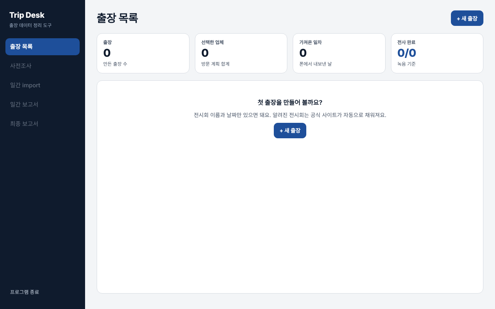

1. 처음엔 출장이 없어요. **+ 새 출장**을 눌러요.
2. 전시회 이름, 장소, 시작일·종료일, 목적을 적고 **만들기**를 눌러요. 목적을 적어 두면 AI 프롬프트에 함께 들어가서 후보를 더 잘 골라줘요.

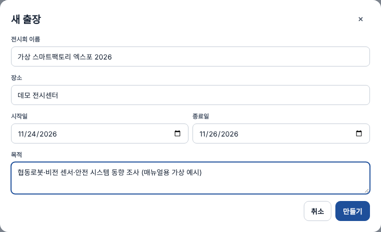

만들면 바로 **사전조사** 화면으로 이동해요. 출장 목록에서는 카드마다 **사전조사 / 보고서 / 삭제** 버튼이 있어요.

### 2-2. 사전조사 화면 구성

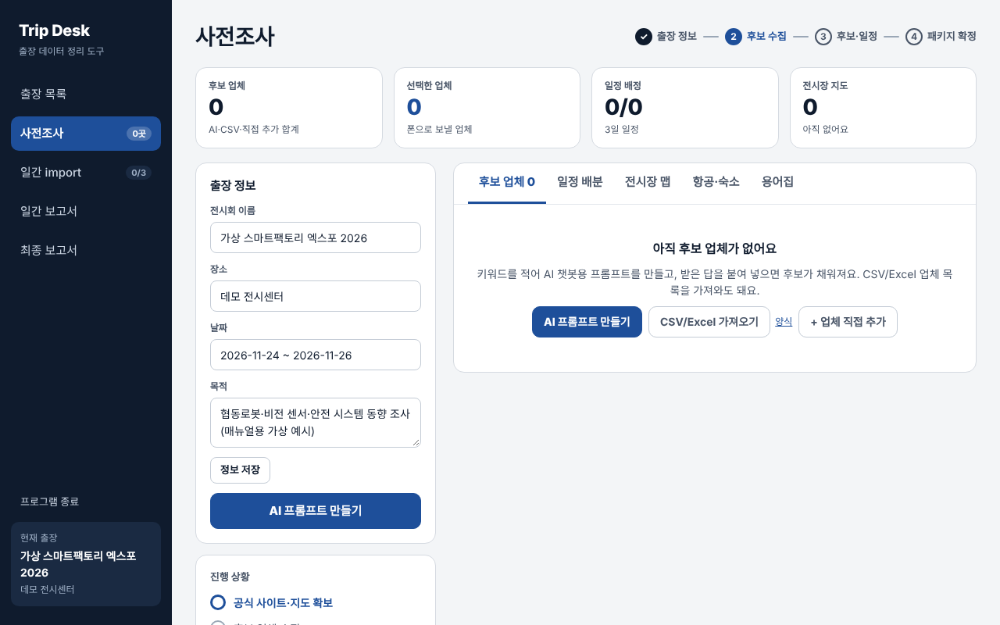

- 맨 위: 단계 표시(출장 정보 → 후보 수집 → 후보·일정 → 패키지 확정)와 숫자 카드(후보 업체, 선택한 업체, 일정 배정, 전시장 지도).
- 왼쪽: **출장 정보**(고칠 수 있어요, 고친 뒤 **정보 저장**), **AI 프롬프트 만들기**, 진행 상황 체크리스트, **맵 PDF 직접 올리기 / URL 붙여넣기**.
- 오른쪽 탭: **후보 업체 · 일정 배분 · 전시장 맵 · 항공·숙소 · 용어집**.

### 2-3. 후보 업체 찾기 (AI 프롬프트 → 붙여넣기)

1. **AI 프롬프트 만들기** → 찾고 싶은 키워드를 쉼표로 적어요 (예: `협동로봇, 용접 로봇, 비전 센서`) → **프롬프트 만들기**.
2. ① 번 칸의 프롬프트를 **복사**해서 쓰는 AI 챗봇(웹 검색 가능한 것)에 붙여 넣어요.

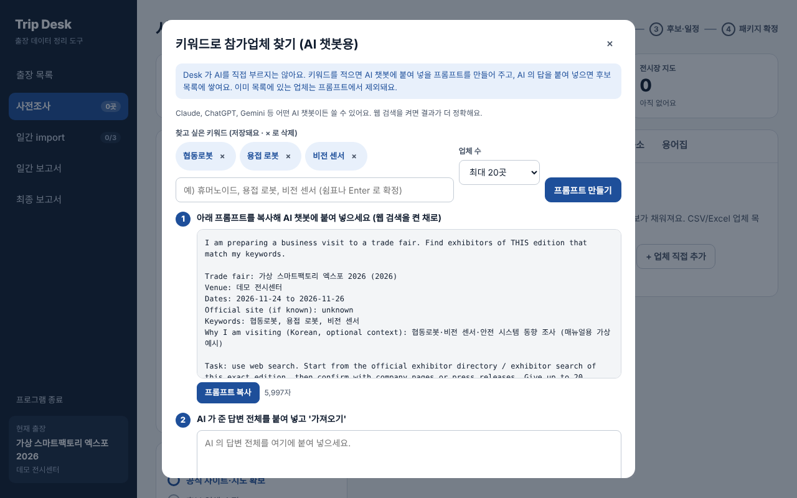

3. AI가 준 **답변 전체**를 ② 번 칸에 붙여 넣고 **가져오기**. 답변 속 ```` ```json ```` 블록만 자동으로 찾아내요.

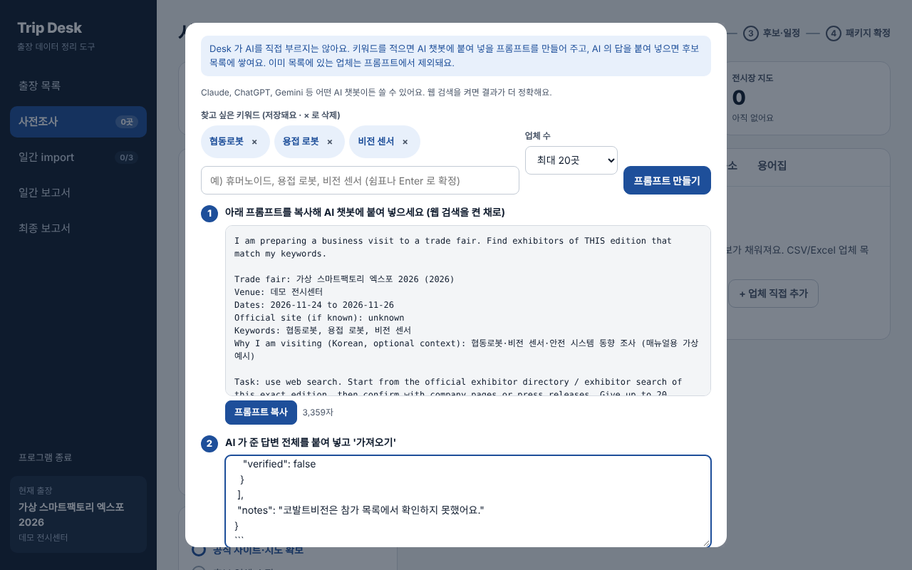

4. 후보 업체 탭에 업체가 추가돼요. 각 업체에는 **참가 확인**(공식 목록에서 확인) / **AI 추정**(확인 못 함) / **내가 추가** 표시가 붙고, 선별 이유 옆 **출처** 링크로 근거 페이지를 열 수 있어요. AI가 지어냈을 수 있으니 'AI 추정' 업체는 꼭 확인하세요.

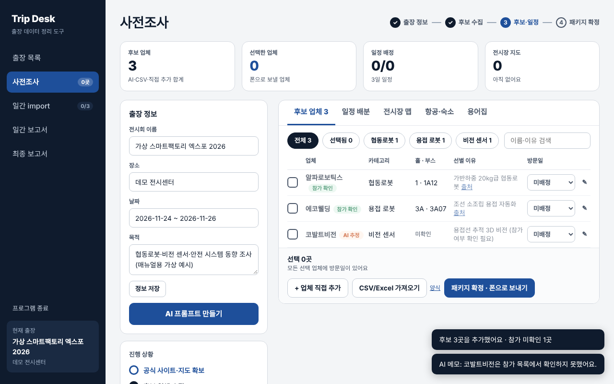

> CSV/Excel 목록이 있으면 **CSV/Excel 가져오기**, 하나씩 넣고 싶으면 **+ 업체 직접 추가**를 써도 돼요.

### 2-4. 후보 선택 · 편집

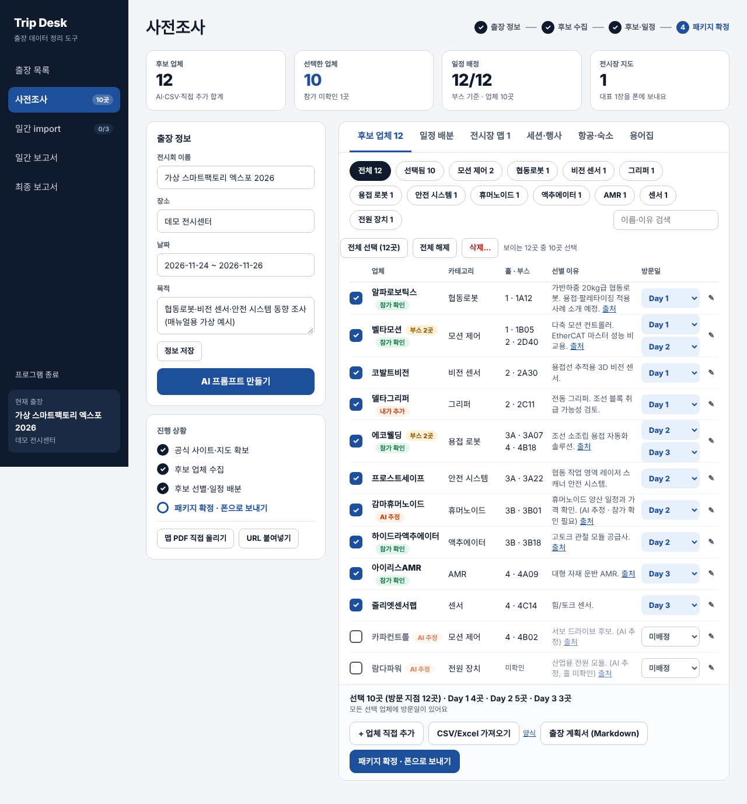

- 체크박스로 **폰으로 보낼 업체**를 골라요(위쪽 숫자 카드의 "선택한 업체"에 반영돼요). 카테고리 칩으로 걸러 볼 수 있어요.
- 각 줄에서 **방문일(Day 1~3)** 을 바로 고를 수 있고, ✎ 로 편집해요.

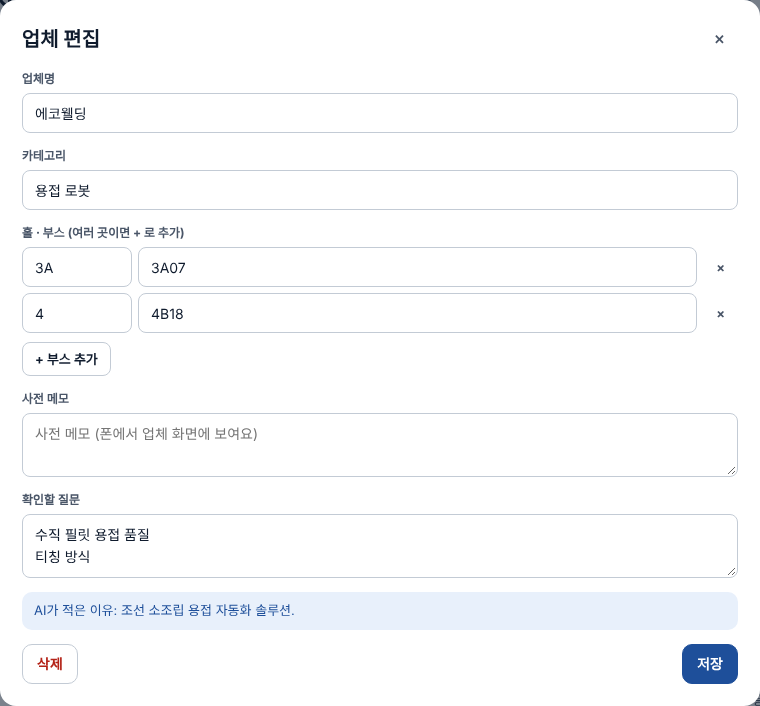

업체 편집에서는 이름·카테고리·홀·부스, **사전 메모**(폰의 업체 화면에 보여요), **확인할 질문**(한 줄에 하나, 폰에서 체크리스트가 돼요)을 적어요.

### 2-5. 일정 배분

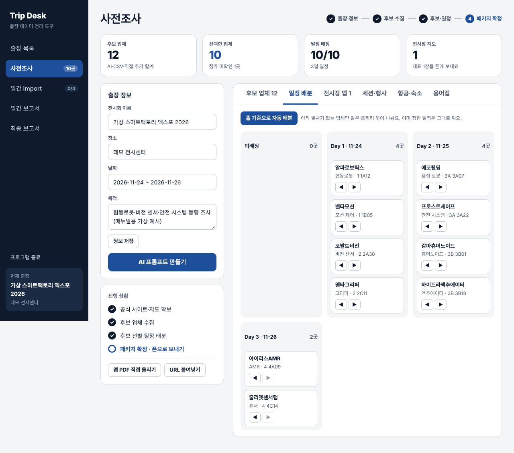

**미배정 · Day 1 · Day 2 · Day 3** 칸에 선택한 업체가 나뉘어 있어요. 업체 카드의 **◀ ▶** 로 앞뒤 일차로 옮겨요. (후보 업체 탭에서 줄마다 방문일 목록으로 바꿔도 같은 결과예요.) 위쪽 **홀 기준으로 자동 배분** 은 아직 일차가 없는 업체만 같은 홀끼리 묶어 나눠 줘요(이미 정한 일정은 그대로). 하단에 "선택 10곳 · Day 1 4곳 · …" 합계가 나와요.

### 2-6. 전시장 맵 · 홀 위치 지정

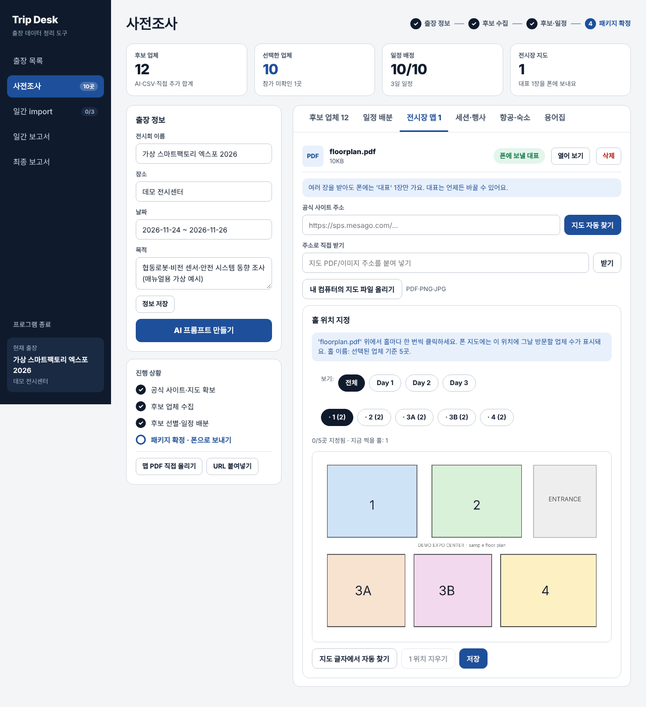

맵은 세 가지 방법으로 넣어요.
- 공식 사이트 주소를 넣고 **지도 자동 찾기**
- **주소로 직접 받기**(PDF/이미지 주소 붙여넣기)
- **내 컴퓨터의 지도 파일 올리기** (PDF·PNG·JPG)

여러 장이면 **대표** 1장만 폰으로 가요(언제든 바꿀 수 있어요).

**홀 위치 지정** 은 폰 맵에 "3A 홀에 오늘 2곳" 같은 핀을 띄우기 위한 기능이에요.

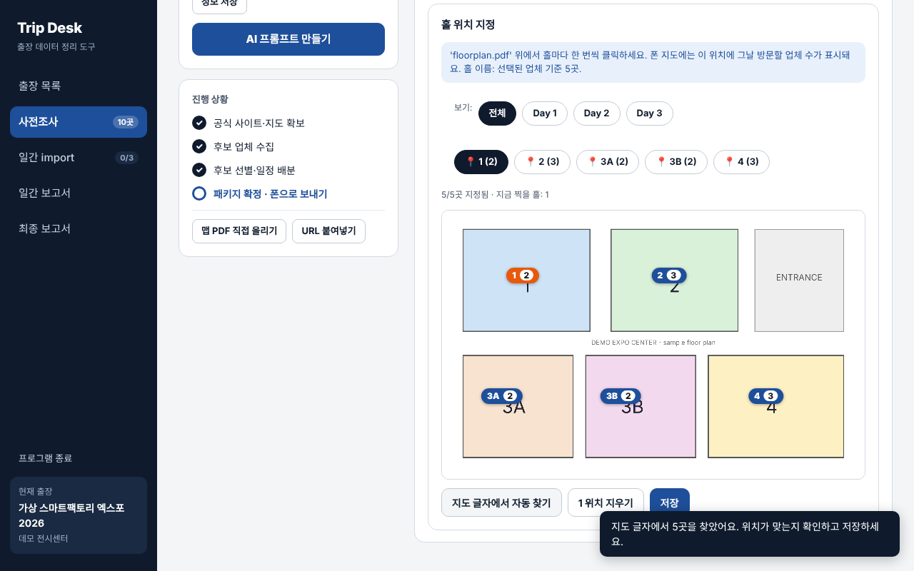

1. **지도 글자에서 자동 찾기** — PDF 안의 글자("1", "2", "3A"…)를 읽어 홀 위치를 찾아줘요. 글자가 그림으로만 들어 있는 맵은 못 찾을 수 있어요.
2. 못 찾은 홀은 위쪽 홀 칩(1, 2, 3A…)을 누른 뒤 **지도에서 그 위치를 클릭**해요. 다시 누르면 위치가 옮겨져요.
3. 잘못 찍은 핀은 **"<홀> 위치 지우기"**, 끝나면 **저장**.

### 2-7. 항공·숙소

여행 전반을 한곳에서 챙기는 탭이에요.

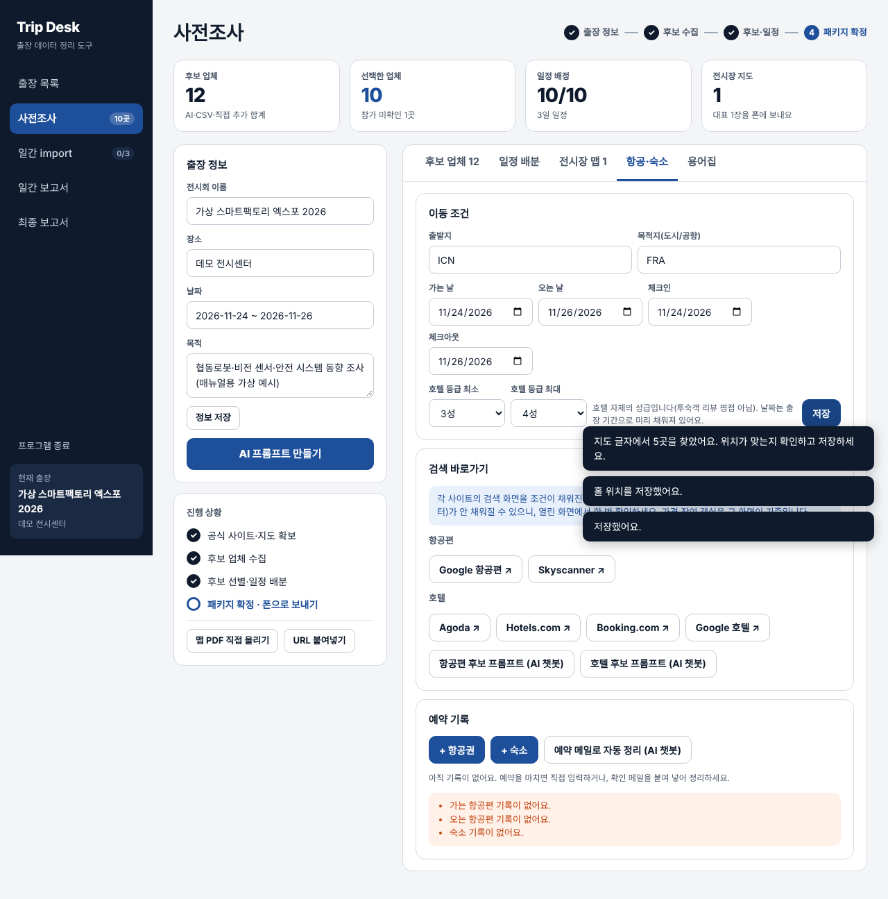

1. **이동 조건**: 출발지·도착지(공항 코드), 가는 날·오는 날, 최소/최대 호텔 등급(**별 등급**, 이용자 리뷰 점수가 아니에요)을 적고 **저장**.
2. **검색 바로가기**: Google 항공편, Skyscanner, Agoda, Hotels.com, Booking.com, Google 호텔 버튼이 조건을 채운 채로 해당 사이트를 열어줘요. (사이트 사정에 따라 일부 조건은 반영되지 않을 수 있어요.)
3. **AI 후보 찾기**: 항공편/호텔 후보 프롬프트 버튼을 눌러 AI 챗봇에 물어보고, 답을 붙여 넣으면 후보가 쌓여요.

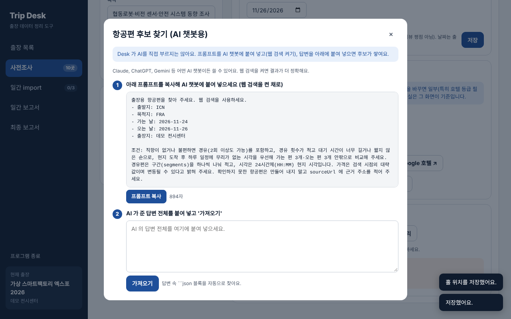

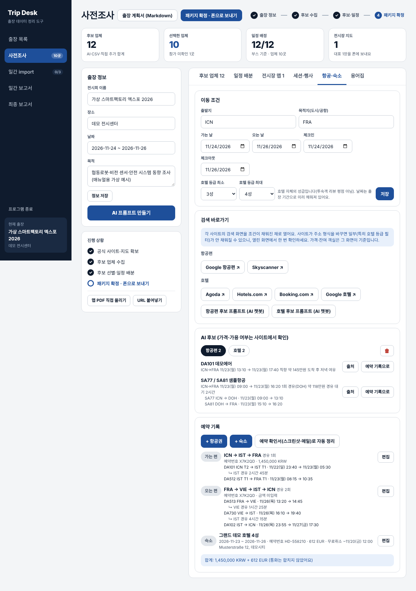

- 후보는 **항공 / 호텔 탭**으로 나뉘어 있고, 탭을 눌러도 화면 위치가 그대로 유지돼요. 후보를 비울 때는 🗑 버튼을 써요.
- **예약 기록**은 폰의 ✈ 버튼(항공·숙소 시트)에 그대로 보여요. 예약번호는 폰에서 **복사**할 수 있어요.

**예약 기록 입력 방법 두 가지**

- 직접: 줄의 **편집** 또는 **+ 추가**.

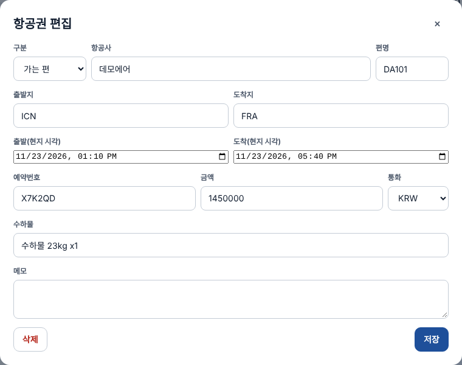

- 예약 확인 메일을 통째로 붙여 넣고 AI로 정리: **예약 메일로 자동 정리 (AI 챗봇)** → 프롬프트를 챗봇에 붙여 넣고 답을 다시 붙여 넣어요. 개인정보(카드번호 등)는 지우고 붙여 넣으세요.

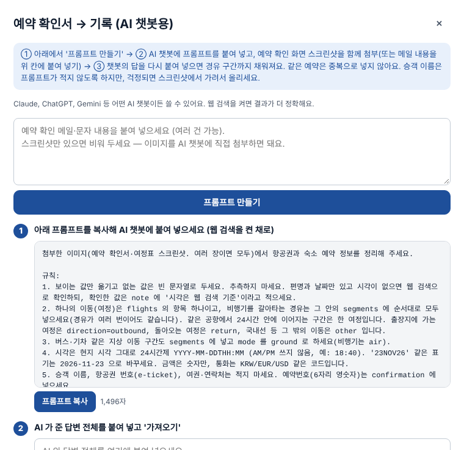

### 2-8. 용어집

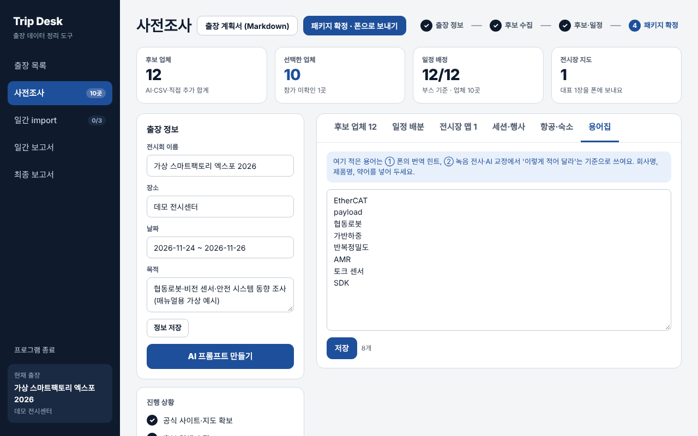

전시회에서 나올 전문 용어를 한 줄에 하나씩 적어요. 녹음을 글로 바꿀 때와 AI 교정에서 **철자 힌트**로 쓰여서 "이더캣" → `EtherCAT` 처럼 바르게 고쳐져요. 폰의 번역에도 같이 가요.

### 2-9. 패키지 확정 · 폰으로 보내기

**패키지 확정 · 폰으로 보내기** 를 누르면 보낼 내용(선택한 업체 수, 대표 지도, 용어 수)을 요약해서 보여줘요. 확인이 필요한 항목(예: 참가 여부 미확인 업체)이 있으면 주황색으로 알려줘요.

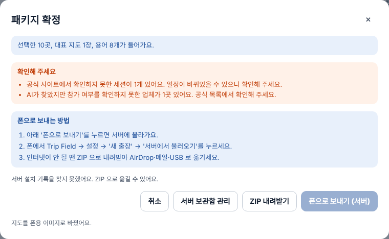

- **폰으로 보내기 (서버)** (기본): 내 서버 보관함에 올려요. 폰에서 "서버에서 불러오기"로 받아요. (설치 기록이 없으면 이 버튼은 꺼져 있어요 — 위 캡처가 그 상태예요.)
- **ZIP 내려받기**: 인터넷이 안 될 때 파일로 옮겨요(AirDrop·USB·메일).

패키지를 다시 보내도 폰에 쌓인 **방문 기록과 질문 체크는 지워지지 않아요**. 같은 출장이면 업체 정보만 갱신돼요.

---

## 3. Trip Field (폰) — 현장에서

폰 앱은 하단 탭 4개(**맵 · 리스트 · 녹음 · 내보내기**)로 움직여요. 상단 바에는 현재 일차(▼로 바꿔요), 온라인/오프라인 표시, **✈**(항공·숙소), **⚙**(설정)이 있어요.

### 3-1. 처음 열었을 때 — 출장 가져오기

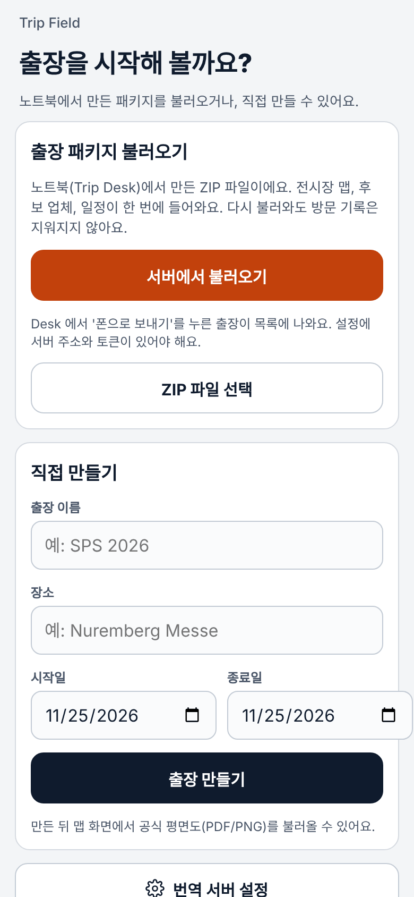

- **서버에서 불러오기**: Desk 에서 "폰으로 보내기"를 누른 출장이 목록으로 나와요.
- **ZIP 파일 선택**: Desk 에서 내려받은 패키지 ZIP 을 직접 골라요.
- **직접 만들기**: 패키지 없이 이름·장소·날짜만 입력해서 시작해요.
- 서버 주소·토큰이 비어 있으면 아래 **번역 서버 설정**으로 가요. (설치 때 받은 **설정 링크**를 폰에서 한 번 열었다면 이미 들어 있어요.)

### 3-2. 설정

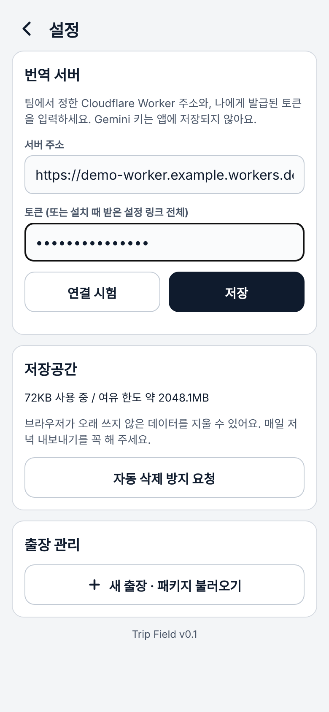

- **서버 주소 / 토큰**: 설정 링크로 자동 입력돼요. 직접 입력할 때는 **연결 시험**으로 확인하고 **저장**. 토큰 칸에 **설정 링크 전체를 붙여 넣어도** 알아서 풀어줘요.
- **저장공간**: 사용량을 보여주고, **자동 삭제 방지 요청**으로 브라우저가 데이터를 함부로 지우지 않게 부탁할 수 있어요.
- **출장 관리**: **+ 새 출장 · 패키지 불러오기**, 출장 삭제(삭제 전 반드시 내보내기를 했는지 확인하세요).

### 3-3. 서버에서 패키지 받기

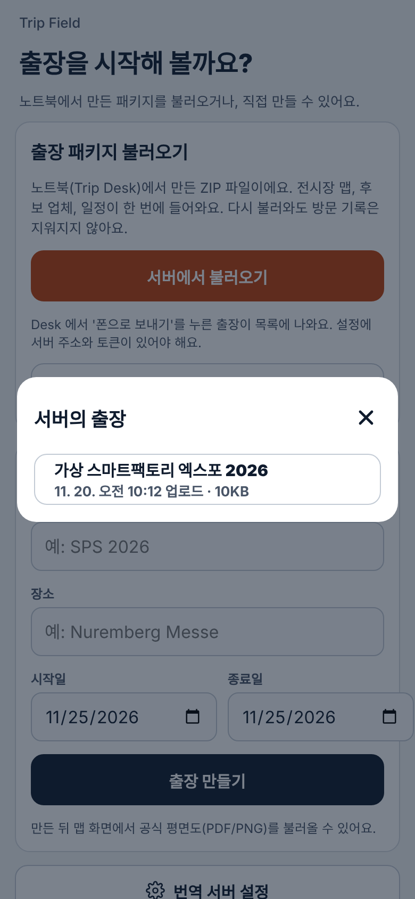

목록에서 출장을 누르면 업체·맵·용어·항공/숙소 정보를 한 번에 받아요.

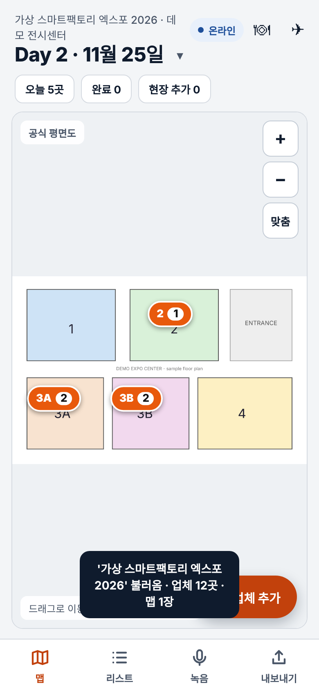

받고 나면 맵 화면으로 넘어가고 "업체 10곳 · 맵 1장"처럼 알려줘요.

### 3-4. 맵 화면

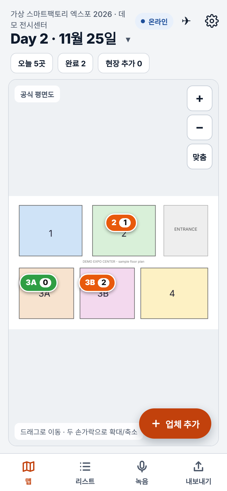

- 위 칩: **오늘 N곳 / 완료 N / 현장 추가 N**.
- 맵은 **두 손가락으로 확대·축소, 드래그로 이동**, **맞춤** 버튼으로 전체 보기.
- 홀마다 **오늘 방문할 남은 업체 수** 핀이 떠요(주황). 오늘 그 홀을 다 돌았으면 **초록 0** 으로 바뀌어요.

핀을 누르면 그 홀에서 오늘 갈 업체와 부스 번호가 나와요.

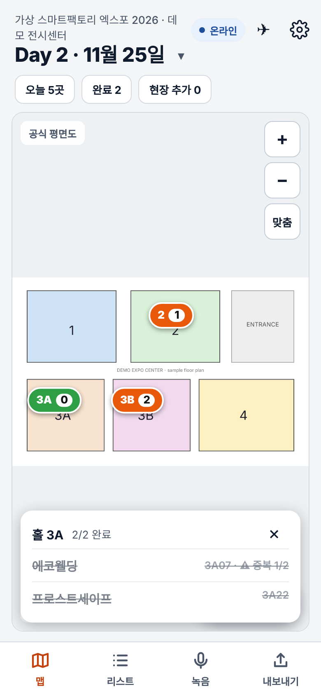

상단 **✈** 를 누르면 항공·숙소 예약이 나와요. 예약번호 옆 **복사** 로 체크인/탑승 때 바로 쓸 수 있어요. 오프라인에서도 보여요.

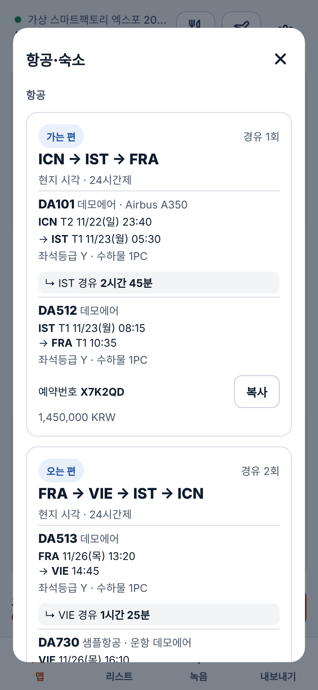

### 3-5. 리스트 — 오늘 갈 곳 체크

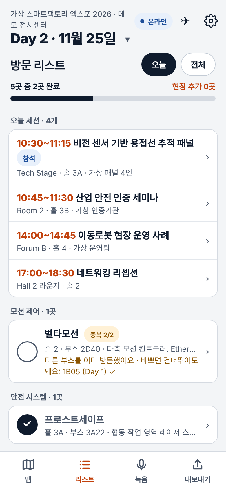

- **오늘 / 전체** 전환, 진행 막대("4곳 중 2곳 완료"), 카테고리별로 묶여 있어요.
- 왼쪽 동그라미를 눌러 **방문 체크**, 줄을 누르면 업체 상세로 들어가요.
- **+ 업체 추가**: 현장에서 새로 발견한 업체를 넣어요(이름·카테고리·홀·부스).

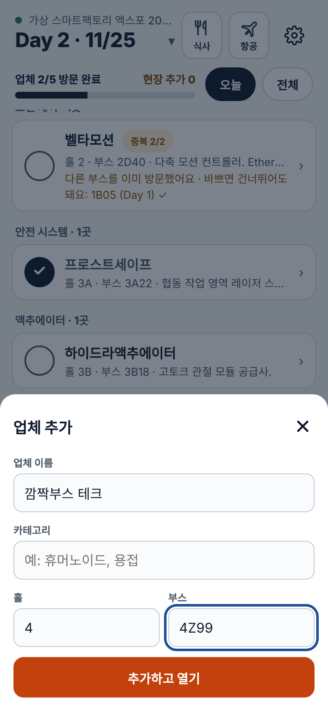

### 3-6. 업체 상세 — 녹음·메모·사진·번역

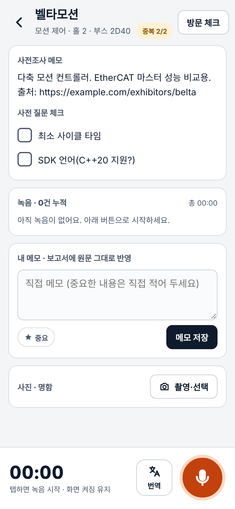

위에서부터:
1. **사전조사 메모 / 사전 질문 체크** — Desk 에서 적어 둔 내용. 물어볼 때마다 체크해요.
2. **녹음** — 아래의 빨간 마이크 버튼으로 시작/정지. 같은 업체를 여러 번 녹음하면 **1차 방문, 2차 방문**으로 쌓여요. 녹음 중에는 **화면을 켜 둔 채 앱을 앞에** 두세요(iPhone).
3. **내 메모** — 직접 적은 메모는 보고서에 **원문 그대로** 들어가요. **중요**(★)를 켜면 보고서에서 강조돼요.
4. **사진** — 촬영·선택. 용량은 자동으로 줄여 저장해요.
5. 하단 **번역** 버튼 — 아래에서 설명해요.

#### 번역

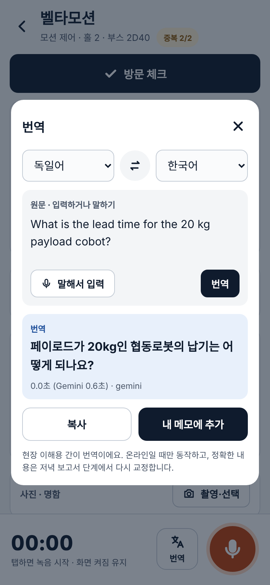

언어를 고르고 **말해서 입력**(마이크) 또는 직접 입력 → **번역**. 결과는 **복사** 하거나 **내 메모에 추가** 로 바로 메모에 남길 수 있어요. 아래에 걸린 시간(전체·Gemini)이 표시돼요. 온라인에서만 동작하고, 문장이 내 번역 서버를 거쳐 Gemini 로 전달돼요.

### 3-7. 녹음 탭

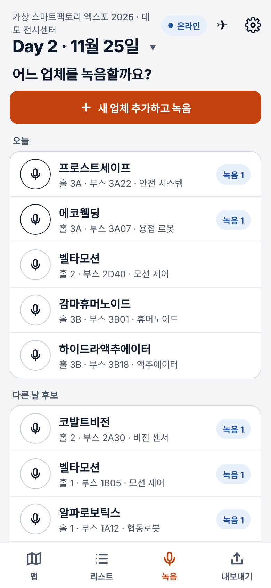

"어느 업체를 녹음할까요?" — 오늘 업체와 다른 날 후보가 나와요. 이미 녹음이 있으면 **녹음 N** 표시. 목록에 없는 업체는 **새 업체 추가하고 녹음**.

### 3-8. 내보내기 — 저녁에 하루치 보내기

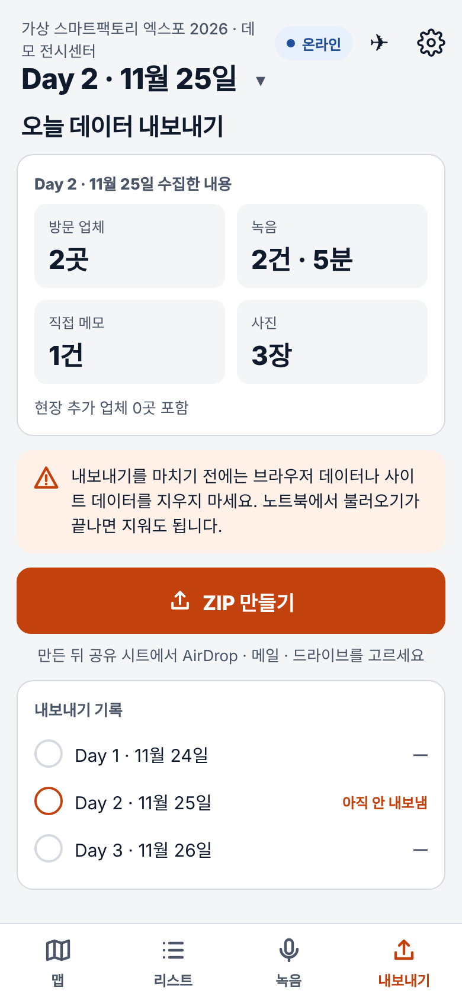

1. 오늘 수집한 방문 업체·녹음·메모·사진 개수를 확인하고 **ZIP 만들기**.
2. 만들어지면 **공유하기 (AirDrop · 메일)** 로 노트북에 보내요. 파일로 저장도 돼요.

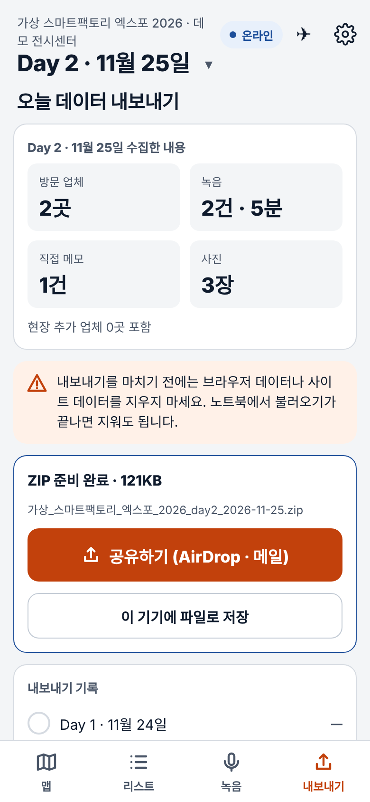

- 아래 **내보내기 기록**에서 일차별로 보냈는지 볼 수 있어요. **노트북에서 가져온 걸 확인하기 전에는 브라우저 데이터를 지우지 마세요.**
- 맵·녹음 등은 오프라인에서도 되지만, 메일 전송은 인터넷이 필요해요.

---

## 4. Trip Desk — 출장 후 보고서

### 4-1. 일간 import (하루치 가져오기)

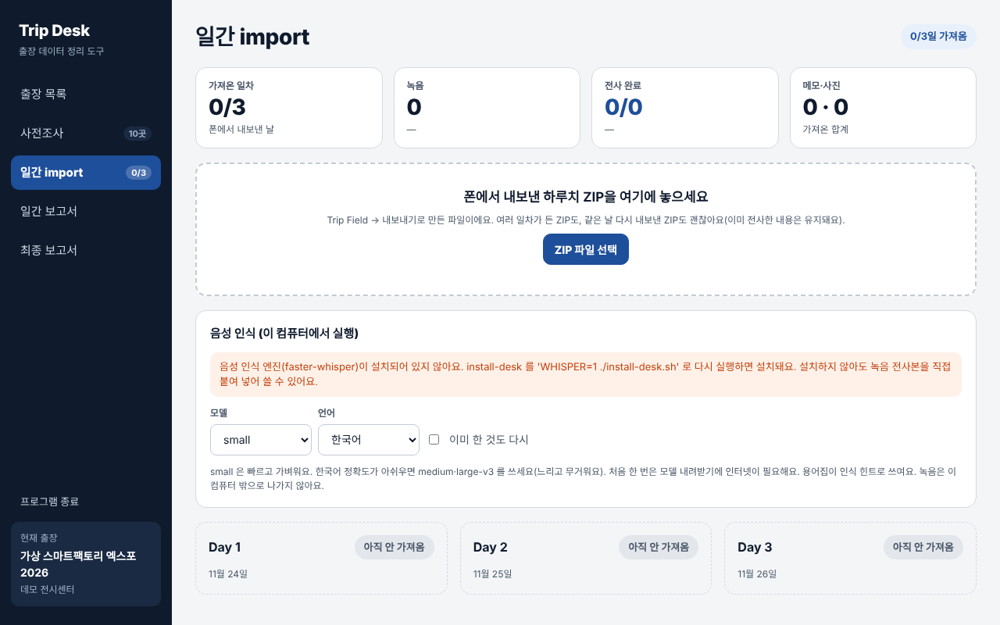

1. 폰에서 보낸 ZIP 을 **ZIP 파일 선택**(또는 파일을 끌어다 놓기)으로 가져와요. ZIP 한 개에 여러 일차가 들어 있어도 되고, 같은 날을 다시 내보낸 ZIP 도 괜찮아요(이미 전사한 내용은 유지돼요). ZIP 은 한 번에 하나씩 가져와요.
2. 일차별 카드에 업체 수·녹음·메모·사진·전사 진행·교정 진행이 나와요.

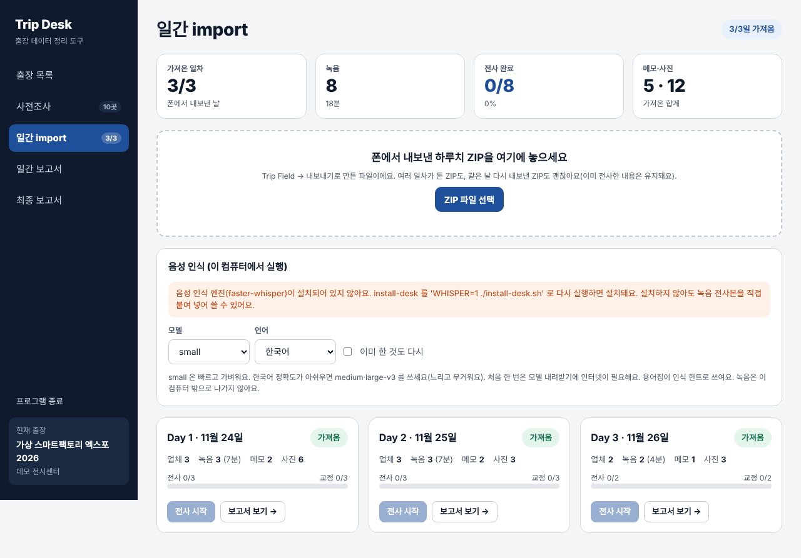

3. 카드의 **전사 시작**을 누르면 이 컴퓨터에서 녹음을 글로 바꿔요(Whisper 설치 시). 위 캡처처럼 "음성 인식" 칸이 주황색이면 아직 설치되지 않은 거예요 — 그래도 괜찮아요, 일간 보고서에서 전사본을 **직접 붙여 넣을 수 있어요**.
4. **보고서 보기 →** 로 일간 보고서에 가요.

### 4-2. 일간 보고서

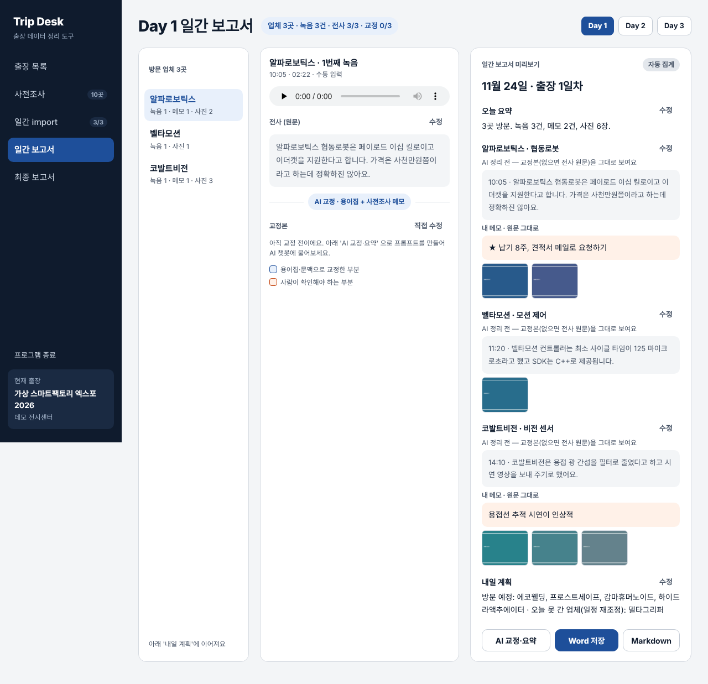

화면은 3열이에요.
- **왼쪽**: 방문 업체 목록. 누르면 해당 업체로 이동.
- **가운데**: 녹음 재생, **전사(원문)**, **교정** 칸. 원문은 **수정**으로 고칠 수 있어요.

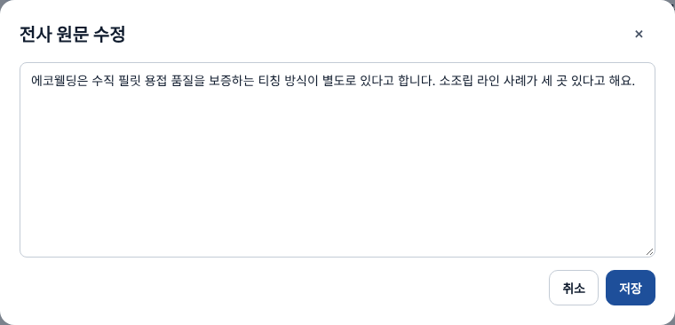

- **오른쪽**: 일간 보고서 초안(오늘 요약, 업체별 핵심 내용, 내 메모·원문 그대로, 사진). 지금은 AI 교정 전이라 "자동 집계" 상태예요.

**AI 교정·요약** 순서:
1. **AI 교정·요약** 버튼 → 프롬프트 복사 → AI 챗봇에 붙여 넣기.

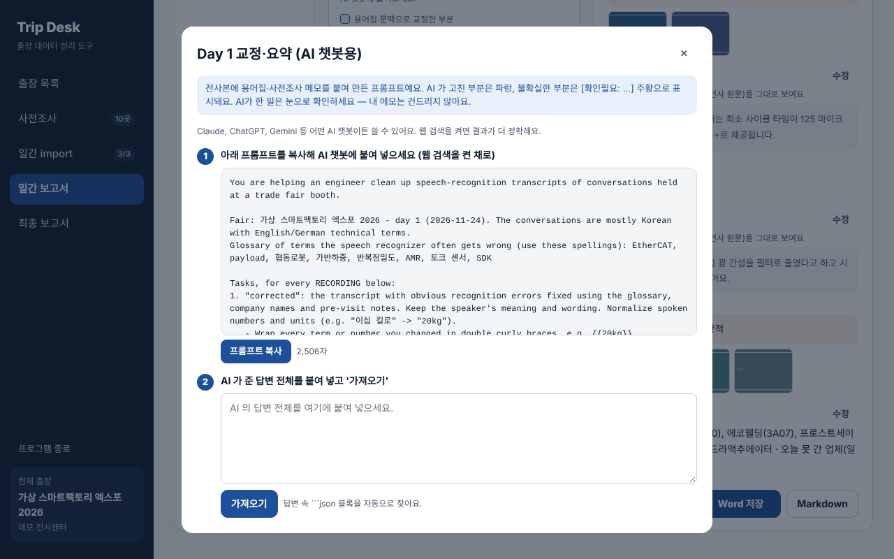

2. 답을 ② 칸에 붙여 넣고 **가져오기**. 교정본·핵심 내용·오늘 요약이 채워져요.

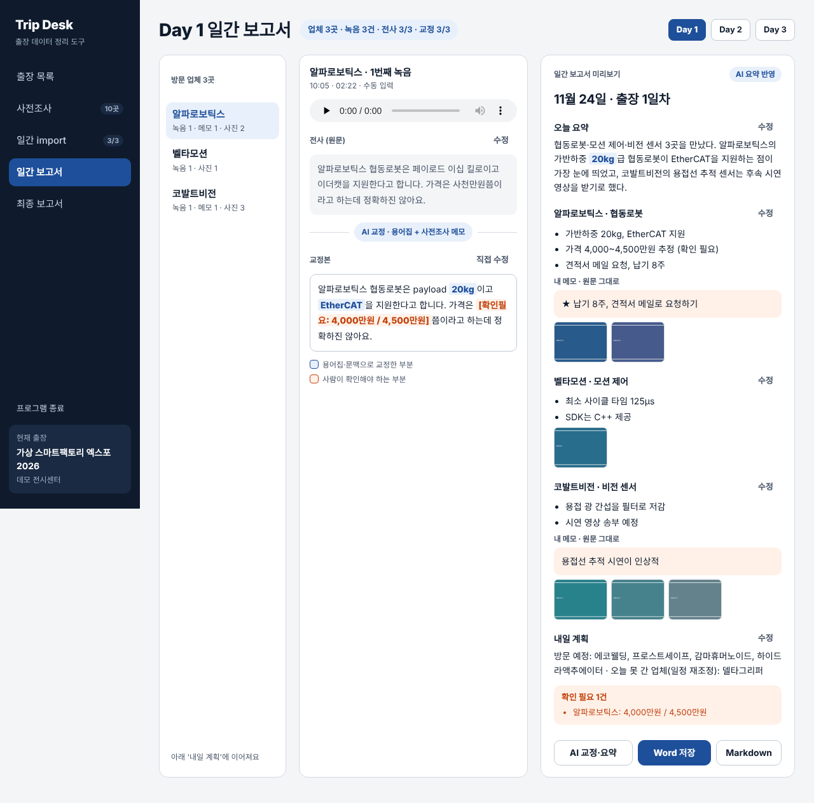

- 파란색 = 용어집·문맥으로 AI가 고친 부분, 주황색 `[확인필요: …]` = AI가 확신하지 못한 부분. **반드시 녹음을 다시 듣고 확인하세요.**
- 내 메모는 AI가 건드리지 않고 **원문 그대로** 들어가요.
- 일차 탭(Day 1·2·3)으로 날짜를 오가요. 어느 부분이든 **수정**으로 직접 고칠 수 있어요.

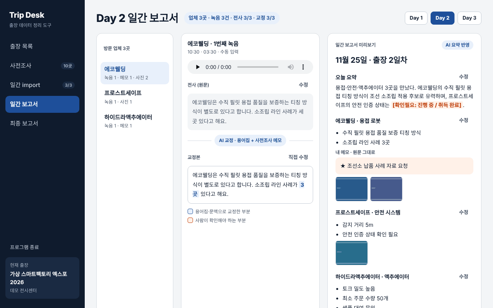

- 오른쪽 위 **Word 저장 / Markdown** 으로 그날 보고서를 파일로 내려받아요.

### 4-3. 최종 보고서

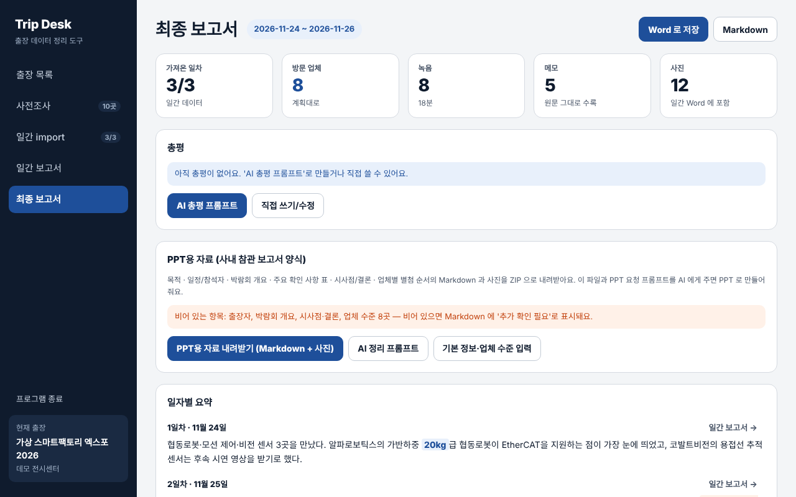

일간 요약을 모아 출장 전체 보고서를 만들어요. 총평은 AI 에게 맡기거나 직접 써요.

- **AI 총평 프롬프트** → 일간 요약과 업체별 핵심이 들어간 프롬프트를 챗봇에 붙여 넣고, 답을 붙여 넣어요.

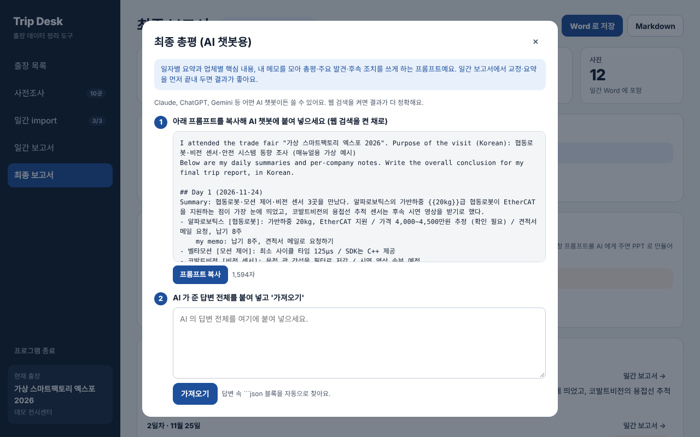

- **직접 쓰기/수정** 으로 총평·주요 발견·후속 조치를 직접 적을 수도 있어요.
- 위 숫자 카드: 가져온 일차, 방문 업체, 녹음, 메모, 사진. 아래로 일자별 요약, 업체별 정리, 방문하지 못한 업체, 확인 필요 항목이 이어져요.
- **Word 로 저장 / Markdown** 은 이 화면 내용 그대로의 간단한 보고서 파일이에요.


### 4-4. PPT용 자료 만들기 (사내 참관 보고서 양식)

팀의 기존 참관 보고서처럼 **목적 → 일정 및 참석자 → 박람회 개요 → 주요 확인 사항(표) → 시사점 및 결론 → 업체별 별첨** 순서로 정리한 **Markdown + 사진 ZIP** 을 만들어요. 이 파일과 PPT 요청 프롬프트를 AI 에게 주면 같은 모양의 PowerPoint 로 만들어 줘요. 최종 보고서 화면의 **"PPT용 자료"** 카드에서 해요.


1. **기본 정보·업체 수준 입력**: 출장자·비고, 박람회 개요(명칭·개요·규모·전시관 구성·슬로건), 그리고 업체마다 **구분 · 수준(1 단기 적용 / 2 추가 검증 / 3 중·장기) · 확인 사항**을 적어요.

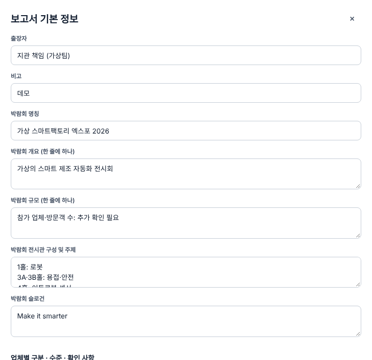

2. **AI 정리 프롬프트**: 일간 보고서 내용을 위 양식(박람회 개요, 업체별 구분·수준·확인 사항·활용처, 시사점 4칸, 결론 3칸)으로 정리하게 하는 프롬프트예요. 챗봇에 붙여 넣고 답을 다시 붙여 넣으면 1번 항목과 시사점·결론·업체별 활용처가 자동으로 채워져요. (박람회 개요는 웹 검색이 되는 챗봇이 정확해요.)
3. 카드의 안내 문구에 **비어 있는 항목**이 나와요. 비워 둔 채 내려받아도 되고, 그 자리는 Markdown 에 **"추가 확인 필요"** 로 표시돼요. AI 가 확신하지 못한 내용도 같은 식으로 남겨 달라고 프롬프트에 들어 있어요.

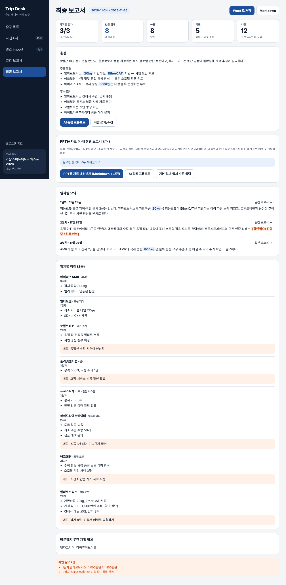

4. **PPT용 자료 내려받기 (Markdown + 사진)**: `최종보고서_PPT용.md` 와 `photos/` 폴더가 든 ZIP 이에요. 업체별 사진은 별첨의 해당 업체 아래에 이미지 링크로 들어가요.
   - 완성 예시: [sample_ppt_report.md](sample_ppt_report.md) (가상 데이터)
5. 그 다음 ZIP 안의 md 와 사진, 그리고 PPT 요청 프롬프트를 AI 에게 주면 PPT 로 만들어 줘요. md 는 텍스트 파일이라 주기 전에 직접 고쳐도 돼요.

> 총평을 고치거나 AI 총평을 다시 받아도 PPT용 자료 내용은 지워지지 않아요.
> 박람회 **배치도 이미지**는 이 ZIP 에 들어 있지 않아요. PPT 에 넣으려면 따로 함께 주세요.

---

## 5. 막힐 때 / 알아둘 한계

| 증상 | 확인 |
|---|---|
| 폰에서 "토큰이 맞지 않아요" | 설치 때 받은 **설정 링크**를 폰에서 다시 열어요. |
| "서버에 패키지 보관함이 아직 없어요" | 노트북에서 `install-worker` 를 다시 실행(업데이트 후 한 번 필요). |
| 서버에 올렸는데 폰 목록에 안 보임 | 반영까지 **1분쯤** 걸릴 수 있어요(KV 특성). 크기는 24MB 까지예요. |
| 맵에 홀 핀이 안 떠요 | Desk → 사전조사 → 전시장 맵 → **홀 위치 지정** 에서 저장했는지, 패키지를 **다시 보냈는지**. |
| 녹음이 끊겨요 (iPhone) | 녹음 중 화면을 켜 두고 앱을 앞에 두세요. 다시 열면 복구를 시도해요. |
| 전사 버튼이 없어요 | Whisper 미설치. `WHISPER=1 ./scripts/install-desk.sh` 로 설치하거나 전사본을 직접 붙여 넣어요. |
| 창이 이상해요 | `~/TripDesk/tripdesk.log` 를 확인해 주세요. |

**정직하게 알려 드려요 — 아직 직접 확인하지 못한 것**
- 실제 Cloudflare 배포(서버·보관함), Windows·Mac 설치 스크립트, 실제 iPhone 에서의 설정 링크와 홈 화면 동작은 이 매뉴얼을 만든 환경에서 실행해 보지 못했어요. 이 매뉴얼의 캡처는 시험용 가상 서버·헤드리스 브라우저로 만든 거예요.
- 녹음 → 글 변환의 실제 정확도, 호텔/항공 사이트 검색 바로가기에서 조건(특히 호텔 등급)이 실제로 반영되는지는 사이트마다 달라요.
- 실제 SPS 같은 공식 평면도에서 홀 위치 자동 찾기가 되는지는 맵 파일에 따라 달라요. 안 되면 수동 지정을 쓰세요.
- 번역·AI 결과는 **참고용**이에요. 중요한 수치와 약속은 원문 녹음·메모로 다시 확인하세요.

---

*이 매뉴얼은 [README](../../README.md) 의 설치 설명과 함께 보세요.*
